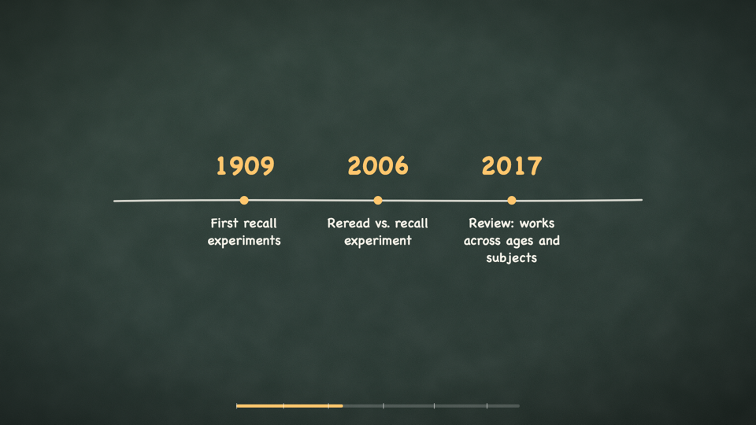

# chalkreel

One-sentence summary: an agent-skill package that turns a measurable learning
objective into a short, code-drawn explainer video with a full accessibility
bundle and QC against written Mayer multimedia-principle criteria — for
e-learning developers, instructional designers, and edtech content teams.

**[Case study & paper trail](docs/index.html)** · **[Skill definition](skill/SKILL.md)** · Role: sole designer, built with agent assistance



> **Evaluation status:** automated script checks, negative tests, compile and
> render verification, and agent-based frame review are complete. No TTS voice
> was recorded in this build run, so no full-length video with audio exists.
> No real learners or subject-matter experts have reviewed any output. See
> `docs/paper-trail/08-qc-report.md` for exactly what ran and what is pending.

## The problem

AI explainer-video generators start from a topic and optimize for engagement.
A learning video has different requirements they ignore: it starts from a
measurable objective, manages cognitive load deliberately, ships captions /
transcript / audio-description notes as first-class deliverables, and keeps
every factual claim traceable to a source. No open-source explainer tool does
any of this.

## My approach

chalkreel is an **agent skill** — a written pipeline a coding agent can
follow — plus small standalone scripts and a Remotion template:

1. **Objective gate** — a topic is rejected; the script validates an
   ABCD-format objective (Audience, Behavior, Condition, Degree). **GATE 1**: human approves objective + beat map.
2. **Research** — claims are extracted with sources into a ledger *before* scripting.
3. **Narration** — segment-budgeted script (10–30 s per beat), AI-writing-tell
   lint must exit 0. **GATE 2**: human approves the script.
4. **Style bake-off** — same beat rendered in 2–3 themes. **GATE 3**: human picks.
5. **Build** — one Remotion component per segment (frames drawn in code: no
   generative video models, no stock footage); TTS with word-level timestamps
   (kokoro-82m default, BYO supported).
6. **Accessibility** — word-aligned SRT, transcript HTML, per-segment
   audio-description notes, and an automated "no info in audio alone" lint.
7. **QC** — scored against written Mayer-principle criteria (segmenting,
   signaling, coherence, redundancy, spatial/temporal contiguity), each with
   pass/fail criteria. **GATE 4**: human reviews the final cut.

## Key design decisions

1. **Objective-first input, enforced by a script** — alternatives: trust the
   agent to "remember" pedagogy. Rationale: a topic cannot be QC'd against;
   an ABCD objective can. Evidence: the gate rejects real topic-style inputs
   (see the negative test below).
2. **Code-drawn frames only** — alternatives: generative video, stock footage.
   Rationale: every frame becomes reviewable, diffable, reproducible, and
   license-clean. Method credited to anything2explainer (no code copied).
3. **Human gates at 4 points** — alternatives: full automation. Rationale:
   instructional quality judgments (is this beat necessary? is this voice
   right?) are the designer's call, not the model's. Pattern from vox-director.
4. **"No info in audio alone" as a lint, not a hope** — alternatives: rely on
   the agent's good intentions. Rationale: most learners watch muted; deaf
   viewers must lose nothing. Evidence: the lint catches numbers spoken but
   never drawn (negative fixture included).
5. **Written QC criteria a machine can score against** — alternatives: "watch
   the video and say if it looks good". Rationale: written pass/fail criteria
   make agent QC auditable and repeatable.

## Evidence and evaluation

What was measured and verified in this build run (all commands reproducible):

- **Negative tests (mandatory, pass):** the seeded bad narration
  (`skill/examples/bad-narration.txt`) trips **29 lint errors** and exits 1;
  the broken storyboard (`skill/examples/bad-storyboard.json`) fails
  `a11y-lint` with **10 violations** (audio-only facts, missing AD notes,
  missing SRT/transcript flags, overlapping timings).
- **Positive tests (pass):** the approved sample narration lints clean (0
  errors, 0 warnings); the objective gate passes the sample objective and
  rejects a bare topic; `make-srt` produces 41 cues covering **250/250**
  narration words, monotonic; `make-transcript` emits every segment with
  on-screen text and AD notes.
- **Compile + render:** the Remotion template passes `tsc --noEmit`, bundles
  with `remotion bundle`, and renders: a 12-second sample (360 frames) plus
  stills from all six segments.
- **Frame QC found and fixed a real defect:** the timeline scene's chalk line
  crossed its labels (spatial contiguity FAIL); fixed, re-rendered, re-checked
  (see `docs/paper-trail/08-qc-report.md`).

**What this evidence cannot show:** that outputs teach anything (no learner
testing — none is claimed), that experts endorse the content (no expert panel
ran), or caption accuracy against real speech (no TTS run). Reviews cited are
**agent heuristic reviews** by the build agent (same model as the author —
disclosed), never human feedback. The sample timing JSON is a **constructed
example**, labeled as such in the file.

## What I'd do next

- Record a kokoro-82m voiceover for the sample and re-verify word alignment
  against real audio (10-cue spot check).
- Run a full 110-second render with audio through GATE 4.
- ~~Agent review round from a fresh context, per the house pattern~~ — done:
  [evaluation/agent-review.md](evaluation/agent-review.md) (fresh-context
  agent review, same-model limitation disclosed; found and fixed 3 script
  bugs and 1 packaging gap, 1 open finding recorded). A multi-model review
  panel remains pending.
- Human protocol: 2–3 educators review one output video (templates to be
  added under `evaluation/`).

## Repository layout

```
skill/      SKILL.md (the pipeline + QC criteria pack), scripts/, examples/
template/   minimal compilable Remotion project (backdrop, scenes, captions, progress bar)
docs/       case-study site + full paper trail of the sample project
evaluation/ METHODS.md (what ran, what is pending)
```

## Tools used

TypeScript, Node.js (zero-dependency scripts), Remotion 4, git + GitHub CLI,
gitleaks. Voice (pending): kokoro-82m. Built with AI assistance; every
generated artifact was reviewed and tested as described above.

## License and attribution

Code: MIT (`LICENSE`). Method credit: [anything2explainer](https://github.com/Vincentwei1021/anything2explainer)
(**PolyForm Noncommercial — method inspiration only, no code or files copied**),
[vox-director](https://github.com/Alisa0808/vox-director) (MIT, gate pattern),
[humanizer](https://github.com/blader/humanizer) and Wikipedia's "Signs of AI
writing" (checklist concept; lint implemented independently). Details:
[ATTRIBUTION.md](ATTRIBUTION.md).

## Accessibility statement

The generated transcript page and `docs/` site are built to WCAG 2.1 AA
targets (headings, landmarks, contrast, 320 px reflow, no motion, descriptive
links) and were checked with automated markup review plus manual inspection.
The skill enforces SRT + transcript + audio-description notes for every video
it produces. Known gap: no manual screen-reader review by a person who uses
assistive technology daily has been performed yet.
